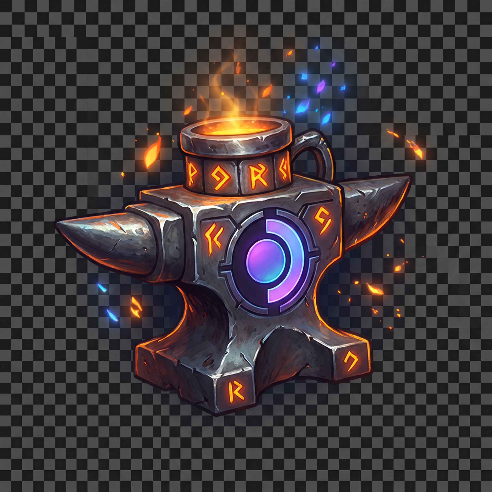

# CurseDeck



**World of Warcraft addons, right from Gaming Mode.**

CurseDeck brings addon management to your Steam Deck through [Decky Loader](https://github.com/SteamDeckHomebrew/decky-loader). Find your WoW installation, see what's installed, and connect to CurseForge to browse, install, and update addons without switching to Desktop Mode.

[Download CurseDeck](https://github.com/deegan/cursedeck/releases/latest) · [Release notes](https://github.com/deegan/cursedeck/releases) · [Report an issue](https://github.com/deegan/cursedeck/issues)

> **CurseForge API key required for online features.** You can find your WoW installation and view existing addons without a key. Searching CurseForge, downloading addons, and checking addon updates require an approved API key.

## Features

- **Find your installation.** Detect WoW in Steam libraries, Proton prefixes, common game folders, and mounted SD cards—including installations made through Battle.net.
- **Choose your edition.** Select Retail, Classic, or another detected installation from a dropdown. Use the folder browser for custom locations.
- **See your addons.** View installed addon names, versions, and descriptions directly from your WoW folder, even offline.
- **Browse CurseForge.** Search for addons filtered to your selected WoW edition.
- **Install dependencies.** Required addon dependencies are included automatically.
- **Keep addons current.** Check for stable releases and update addons managed by CurseDeck individually or together.
- **Update CurseDeck in Gaming Mode.** Get notified about new plugin releases and install them through Decky's confirmation dialog.

## Install

You'll need Decky Loader and a World of Warcraft installation on your Steam Deck. Internal storage and SD cards are supported.

1. Download **[CurseDeck.zip](https://github.com/deegan/cursedeck/releases/latest/download/CurseDeck.zip)** onto your Steam Deck.
2. Open Decky's settings and enable developer mode.
3. Use Decky's **Install plugin from ZIP** option and select the downloaded file.
4. Open **CurseDeck** from the Decky panel.

## Find your WoW addons

1. Open **Setup**. CurseDeck scans for WoW installations during first-time setup.
2. Choose your edition from the **WoW installation** dropdown.
3. Select **Show my addons**.

If your installation isn't listed, select **Find WoW installations** to scan again, or **Browse SD card or game folder** to choose its location. You can select the SD card or the World of Warcraft folder; CurseDeck searches inside it and lists the editions it finds.

Multiple installations of the same edition are numbered, with the selected location shown beneath the dropdown. You can switch installations from Setup at any time.

**My addons** shows the scanned folder and a compact list of addon names and versions. Select an addon to expand its description, folder, and other details. Available updates and issues are marked on the collapsed row. Use **Refresh installed addons** after making changes with another addon manager.

### Existing addons

Addons already present in your WoW folder show **Installed outside CurseDeck** in their expanded details. Their names and versions are available without an API key, and CurseDeck leaves their files in place.

**My addons → Check for updates** also recognises existing addons. CurseDeck fingerprints each folder the way the CurseForge app does and asks CurseForge which release it is. An addon that matches a release exactly is listed as **Recognised on CurseForge** and can be updated like one CurseDeck installed: updating replaces its folders with the new release. Nothing on disk changes until you choose to update. Folders that were edited or come from elsewhere do not match and are left alone.

Some authors only allow downloads through CurseForge's own app or website. CurseDeck shows when those addons have an update, but cannot install it.

## Connect to CurseForge

Request an API key approved for third-party use through [CurseForge's API application process](https://support.curseforge.com/support/solutions/articles/9000208346-about-the-curseforge-api-and-how-to-apply-for-a-key). A regular CurseForge account alone does not provide API access.

Once your key is approved:

1. Open **Setup** and enter your **CurseForge API key**, or choose **Load API key from a text file** and pick a file containing only the key.
2. Select **Load WoW editions**.
3. Choose the edition matching your selected WoW installation.
4. Select **Save setup**.

Your key is saved locally in Decky's plugin settings. Leave the key field blank when changing other settings to keep the saved key.

Some authors disable third-party downloads for their addons. CurseDeck respects those settings, so availability may differ from the CurseForge app.

## Install and update addons

Close WoW before installing or updating addons.

- **Find addons:** Search by name, browse the results, and select **Install**. CurseDeck also installs required dependencies.
- **My addons → Check for updates:** Look for newer stable releases of addons managed by CurseDeck.
- **Update / Update all:** Install an individual update or all available updates.
- **Repair / reinstall:** Expand a managed addon's details to restore its current release.

CurseDeck checks download integrity and stages addon files before replacing managed folders. Updates preserve your WoW `WTF` settings. Personal changes inside a managed addon's own folder are replaced during updates.

## Keep CurseDeck up to date

CurseDeck checks GitHub for new plugin releases when Decky loads and every six hours while Steam is running. You can disable automatic checks in **Plugin updates** or check manually whenever you like.

To update, open **Plugin updates**, select **Install CurseDeck [version]**, and confirm Decky's installation dialog. CurseDeck downloads and verifies the package before handing it to Decky for installation. The update screen retains the attempt status across reloads and confirms success when the new package version is loaded.

Plugin updates do not require a CurseForge API key. If an update does not complete, the latest release ZIP can also be installed through Decky's ZIP installer.

## Try the offline demo

Choose **Setup → Try offline demo** to explore searching, installing, and updating sample addons without an API key or a WoW installation.

Demo addons are clearly marked and stored separately from your game. Select **Leave demo and find my addons** to return to your real installation.

## Troubleshooting

**My WoW installation isn't listed.**

Check that the SD card or game drive is mounted. Use **Browse SD card or game folder** to select the card or WoW folder. **Use a custom location** provides manual path entry for unusual setups.

**My addons list is empty.**

Check the scanned path shown in **My addons** and make sure you selected the edition you play. Then select **Refresh installed addons**.

**I see Quest Compass or Shared Library marked demo.**

You're viewing the offline demo. Select **Leave demo and find my addons**, choose your WoW installation, and press **Show my addons**.

**CurseForge search or downloads aren't available.**

Save an approved API key and the matching CurseForge edition in Setup. Check your connection and any error shown in the panel.

**An addon is listed but has no Update button.**

Addons installed outside CurseDeck can be viewed, but are not automatically adopted for online updates.

For other problems, [open an issue](https://github.com/deegan/cursedeck/issues) with your CurseDeck and Decky Loader versions, the steps you followed, and the error message. Never include your API key.

## Build from source

Requires Node.js/npm and Python 3.9 or newer.

```sh
npm ci
npm test
npm run test:frontend
npm run package
```

The installable package is written to `out/CurseDeck.zip`. To exercise the addon workflow without network access or game files:

```sh
python3 scripts/demo_smoke.py
```

[GitHub Actions](https://github.com/deegan/cursedeck/actions/workflows/build.yml) runs the tests and produces downloadable build artifacts. Version tags publish release packages and their update manifests.

---

CurseDeck is an independent project and is not affiliated with Blizzard Entertainment, CurseForge, Overwolf, or Decky Loader.
